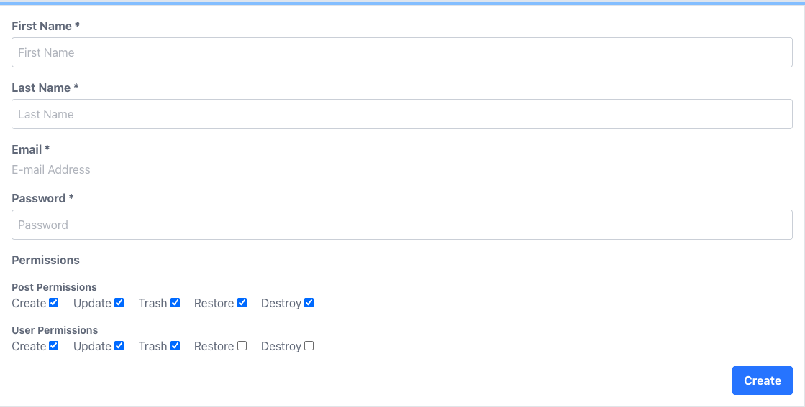

# Lara Permissions

- [About](#About)
- [Installation](#Installation)
- [Setup](#Setup)
- [Getting Started](#Getting-Started)
- [Creating Super Admin](#Creating-Super-Admin)
- [Policy Methods and Required Permissions](#Policy-Methods-and-Required-Permissions)
- [Assigning Permissions To Users](#Assigning-Permissions-To-Users)
- [Adding Custom Permissions](#Adding-Custom-Permissions)

## About

A Laravel package that allows you to integrate permissions into your application.

## Installation

Install with `composer require njdigitallab/larapermissions`.

## Setup

1) Publish the package migration via `php artisan vendor:publish --tag=larapermissions-migrations`.

2) Run the artisan command `php artisan migrate`.

3) Add the `NjDigitalLab\LaraPermissions\Traits\LaraPermissions` trait to your User model.

```php
<?php

namespace App\Models;

...
use NjDigitalLab\LaraPermissions\Traits\LaraPermissions;

class User extends Authenticatable
{
    use LaraPermissions;
}
```

This provides two useful method, which are `isSuperAdmin` and `getPermissions`.

```php
// Check if the user is a super admin. Returns true or false.
$user->isSuperAdmin(); 

// Get an array of the user permissions
$user->getPermissions();

// $user->getPermissions() Example Output
['user:create', 'user:update', 'post:create', 'post:update', 'post:trash']
```

Getting and setting attributes is also handled by the trait.

## Getting Started

Create a policy with the artisan command `php artisan larapermissions:policy PostPolicy`.

This will create a `PostPolicy.php` file in your `App/Policies` directory and a `PostPermissions.php` file in your `App/Permissions` directory.

The policy file is already setup to read from your permissions file and generally does not need further configuration.

```php
<?php

namespace App\Policies;

use App\Permissions\PostPermissions;
use NjDigitalLab\LaraPermissions\Policy;

class PostPolicy extends Policy
{
    /**
     * Get the permissions class name.
     */
    public function getPermissionsClassName(): string
    {
        return PostPermissions::class;
    }
}
```

If you are using a `UserPolicy`, extend the `NjDigitalLab\LaraPermissions\UserPolicy` class instead. This has more sensible policy checks that are more user specific.

```php
<?php

namespace App\Policies;

use App\Permissions\UserPermissions;
use NjDigitalLab\LaraPermissions\UserPolicy as Policy;

class UserPolicy extends Policy
{
    /**
     * Get the permissions class name.
     */
    public function getPermissionsClassName(): string
    {
        return UserPermissions::class;
    }
}
```

## Creating Super Admin

Run the artisan command `php artisan larapermissions:create-super-admin`.

The Super Admin will be able to perform any action, except trash/restore/destroy themselves.

By default, super admin creation will ask for a first and last name. If you are using name only, in the boot method of your service provider, call the `LaraPermissions::useNameOnly` method. The creation script will only ask for a name now, and not first and last name.

```php
<?php

namespace App\Providers;

use Illuminate\Support\ServiceProvider;
use NjDigitalLab\LaraPermissions\LaraPermissions;

class AppServiceProvider extends ServiceProvider
{
    /**
     * Register any application services.
     */
    public function register(): void
    {
        //
    }

    /**
     * Bootstrap any application services.
     */
    public function boot(): void
    {
        LaraPermissions::useNameOnly();
    }
}
```

## Policy Methods and Required Permissions

```php
public function menu(Model $user): bool
// Must have at least one of the available permission.

public function viewList(Model $user): bool
// Must have either the update or trash permission

public function viewTrashList(Model $user): bool
// Must have either the restore or destroy permission

public function create(Model $user): bool
// Must have the create permission

public function view(Model $user, Model $model): bool
// Must have the update permission

public function update(Model $user, Model $model): bool
// Must have the update permission

public function trash(Model $user, Model $model): bool
// Must have the trash permission

public function restore(Model $user, Model $model): bool
// Must have the restore permission

public function destroy(Model $user, Model $model): bool
// Must have the destroy permission

public function performCreate(Model $user): bool
// Must have the create permission

public function performView(Model $user): bool
// Must have the update permission.

public function performUpdate(Model $user): bool
// Must have the update permission

public function performTrash(Model $user): bool
// Must have the trash permission

public function performRestore(Model $user): bool
// Must have the restore permission

public function performDestroy(Model $user): bool
// Must have the destroy permission

public function performSearch(Model $user): bool
// Must have either of the update, trash, restore or destroy permission

public function performBulkRequest(Model $user): bool
// Must have either of the trash, restore or destroy permission
```

## Assigning Permissions to Users

To assign permissions to users, get the list of available permissions by calling the `NjDigitalLab\LaraPermissions\PermissionsList::getPermissionsList()`. This will fetch the list of permissions available based on the Policies that have been created so far.

For example, if you created a `PostPolicy.php` and `UserPolicy.php` file, the following permissions will be available:

```php
[
    'post' => ['post:create', 'post:update', 'post:trash', 'post:restore', 'post:destroy'],
    'user' => ['user:create', 'user:update', 'user:trash', 'user:restore', 'user:destroy'],
]
```

In your create/edit user view file, you can loop through the array and display the permissions and use checkboxes to select which permissions the user should have. The submitted permissions should be saved to the `permissions` attribute on the user model.



## Adding Custom Permissions

By default, `create`, `update`, `trash`, `restore`, `destroy` are the only available permissions. If you want to add another permission to the mix, you have to define a `customPermissions` method on your permissions class that will return an array of permissions. The array key is the name that you will use for the policy checks and the value will be the list of permissions needed for the policy check to pass.

```php
...

class UserPermissions extends Permissions
{
    ....

    public static function customPermissions(): array
    {
        $id = static::getDomainId();

        return ['download' => [$id.':download']];
    }
}
```

Then in your policy file, you will add the check.

```php
...

class UserPolicy extends Policy
{
    /**
     * Get the permissions class name.
     */
    public function getPermissionsClassName(): string
    {
        return UserPermissions::class;
    }

    /**
     * Check if the user can download.
     */
    public function download(User $user, Model $model): bool
    {
        if ($user->isSuperAdmin()) {
            return true;
        }
        
        return $this->hasAbility('download');
    }
}
```